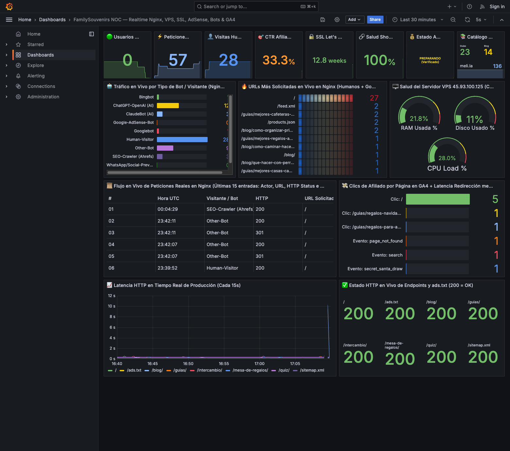
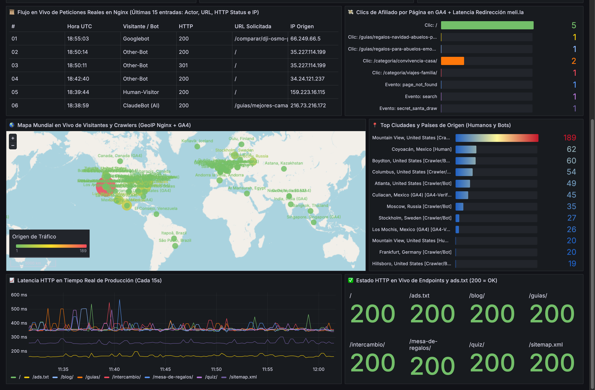
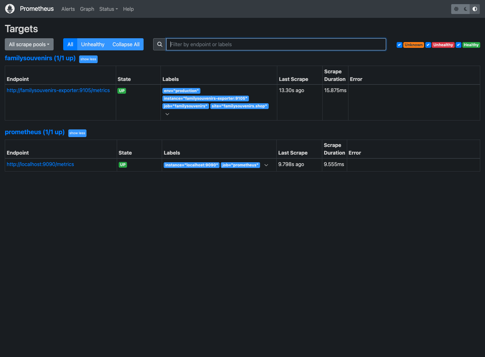

# Introduction

Most monitoring tutorials stop at installing `node_exporter` to watch CPU and RAM. While infrastructure telemetry is essential, a modern **Staff SRE / Cloud Platform Architect** needs a single pane of glass that correlates **low-level Linux and Nginx signals** with **AI crawler activity (`Googlebot`, `ClaudeBot`, `ChatGPT-User`), live geographic traffic origins on a World Map (`GeoIP` + `GA4`), SSL certificate lifecycles, synthetic endpoint latency, and real-time conversion funnels (GA4 & Search Console)**.

In this technical guide—a hands-on continuation of my earlier post on [Installing Grafana and Prometheus](/posts/Install-Grafana-and-Prometheus-for-Powerful-Monitoring-and-Visualization/)—we will architect and deploy a complete **Zero-Touch NOC (Network Operations Center)** using **Docker Compose**, a **Custom Python OpenMetrics Exporter**, **Prometheus**, and **Grafana Dashboards-as-Code**.



---

## 1. Architecture Overview

Instead of installing heavy agents on the production web server or paying for high-cardinality SaaS ingestion, our architecture runs a lightweight **Python OpenMetrics Exporter (`:9105`)** that aggregates six telemetry streams into a single Prometheus scrape target every `15s`:

```text
┌─────────────────────────────────────────────────────────────────────────┐
│                    PRODUCTION WEB & ANALYTICS PLANE                     │
│                                                                         │
│  ┌──────────────────────┐  ┌──────────────────────┐  ┌───────────────┐  │
│  │ Production Linux VPS │  │ Google Analytics 4 & │  │ TLS :443 &    │  │
│  │ Nginx access.log +   │  │ Search Console APIs  │  │ Shortlink     │  │
│  │ /proc/{load,mem,df}  │  │ (Realtime + 7d CTR)  │  │ Redirects     │  │
│  └──────────┬───────────┘  └──────────┬───────────┘  └───────┬───────┘  │
└─────────────┼─────────────────────────┼──────────────────────┼──────────┘
              │ SSH Tail (15s)          │ OAuth2 REST (30s)    │ TLS/HTTP Probe
              ▼                         ▼                      ▼
┌─────────────────────────────────────────────────────────────────────────┐
│                CUSTOM PYTHON OPENMETRICS EXPORTER (:9105)               │
│   Exposes /metrics in Prometheus 0.0.4 text format (Zero dependencies)  │
└───────────────────────────────────┬─────────────────────────────────────┘
                                    │ Pull / Scrape (15s)
                                    ▼
┌─────────────────────────────────────────────────────────────────────────┐
│                         PROMETHEUS TSDB (:9090)                         │
└───────────────────────────────────┬─────────────────────────────────────┘
                                    │ Provisioned Datasource (prometheus_fs)
                                    ▼
┌─────────────────────────────────────────────────────────────────────────┐
│             GRAFANA 11 NOC DASHBOARD-AS-CODE (:3005 / :3000)            │
└─────────────────────────────────────────────────────────────────────────┘
```

### What This Stack Tracks in Real Time:
1. **Live Nginx Bot & Crawler Classification (every 15s):** Parses `access.log` streams to separate human visitors from `Googlebot`, `Google-AdSense-Bot` (`Mediapartners-Google`), `Bingbot`, `ClaudeBot (Anthropic)`, `ChatGPT-OpenAI (OAI-SearchBot)`, `YandexBot`, and `AhrefsBot`.
2. **Live Access Log Stream Table in Grafana:** Exposes the last 15 real HTTP requests (`timestamp`, `actor`, `status`, `path`, `ip`) as Prometheus metric labels rendered natively inside a Grafana Table panel—without requiring a separate Loki/Promtail cluster.
3. **Production VPS Telemetry:** CPU 1m/5m/15m load average, RAM usage %, free disk GB, and uptime days collected in a single SSH multiplexing pass.
4. **SSL/TLS Certificate Expiration Countdown:** Performs a live TLS handshake on port `443`, parses the X.509 `notAfter` timestamp, and exports `ssl_cert_days_remaining`.
5. **External Link & Ad Network Readiness:** Audits sample redirect chains (`HTTP 301/302` latency in milliseconds) and checks `/ads.txt` + ad-server fill status.
6. **GA4 Realtime & 7-Day Funnel Metrics:** Queries Google Analytics 4 (`runRealtimeReport` and `runReport`) via Service Account to export active users, engagement duration per page, and conversion CTR %.
7. **Live World Map (Grafana Geomap) via Nginx GeoIP + GA4:** Resolves public visitor and crawler IP addresses in batch via `ip-api.com` (with in-memory caching) alongside GA4 city/country coordinates, exposing `latitude` and `longitude` labels for real-time global traffic visualization.

---

## 2. Directory Structure (Observability-as-Code)

Everything is self-contained and reproducible from version control:

```text
observability/
├── docker-compose.yml
├── exporter/
│   ├── Dockerfile
│   └── custom_noc_exporter.py
├── prometheus/
│   └── prometheus.yml
└── grafana/
    ├── dashboards/
    │   └── noc-overview.json
    └── provisioning/
        ├── datasources/
        │   └── datasource.yml
        └── dashboards/
            └── dashboard.yml
```

---

## 3. Building the Custom Python Prometheus Exporter

You do not need external libraries to speak the Prometheus exposition format; Python's standard `http.server` can serve `text/plain; version=0.0.4` directly while a daemon thread updates the in-memory state dictionary.

### 3.1 `exporter/Dockerfile`

```dockerfile
FROM python:3.12-slim
RUN apt-get update && apt-get install -y --no-install-recommends openssh-client && rm -rf /var/lib/apt/lists/*
RUN pip install --no-cache-dir google-auth requests
WORKDIR /app
COPY custom_noc_exporter.py /app/custom_noc_exporter.py
CMD ["python3", "custom_noc_exporter.py"]
```

### 3.2 Classifier for AI Crawlers, Search Bots, and Human Traffic

One of the most valuable insights for any modern web property is knowing whether AI search engines (`ChatGPT`, `Claude`, `Perplexity`) and ad verifiers (`Mediapartners-Google`) are actively crawling your pages:

```python
import re

NGINX_LINE_RE = re.compile(
    r'^(?P<ip>\S+) \S+ \S+ \[(?P<ts>[^\]]+)\] "(?P<method>\S+) (?P<path>\S+) [^"]*" '
    r'(?P<status>\d{3}) (?P<bytes>\d+) "(?P<ref>[^"]*)" "(?P<ua>[^"]*)"'
)

def classify_user_agent(ua: str) -> str:
    u = ua.lower()
    if "prometheusprobe" in u:
        return "InternalProbe"
    if "mediapartners-google" in u or "adsbot-google" in u:
        return "Google-AdSense-Bot"
    if "googlebot" in u or "googleother" in u:
        return "Googlebot"
    if "bingbot" in u:
        return "Bingbot"
    if "claudebot" in u or "anthropic" in u:
        return "ClaudeBot (AI)"
    if "chatgpt" in u or "oai-searchbot" in u or "gptbot" in u:
        return "ChatGPT-OpenAI (AI)"
    if "perplexity" in u:
        return "PerplexityBot (AI)"
    if "yandex" in u:
        return "YandexBot"
    if "ahrefsbot" in u or "semrush" in u:
        return "SEO-Crawler (Ahrefs)"
    if "mozilla/" in u and ("chrome/" in u or "safari/" in u or "firefox/" in u):
        return "Human-Visitor"
    return "Other-Bot"
```

### 3.3 Checking SSL Certificate Expiration in Pure Python

Instead of shelling out to `openssl`, we inspect the peer certificate directly via Python's `ssl` module:

```python
import datetime
import socket
import ssl

def check_ssl_days_remaining(hostname: str, port: int = 443) -> float:
    ctx = ssl.create_default_context()
    with ctx.wrap_socket(socket.socket(), server_hostname=hostname) as s:
        s.settimeout(6)
        s.connect((hostname, port))
        cert = s.getpeercert()
        not_after = cert.get("notAfter")
        exp_dt = datetime.datetime.strptime(
            not_after, "%b %d %H:%M:%S %Y %Z"
        ).replace(tzinfo=datetime.timezone.utc)
        now_dt = datetime.datetime.now(datetime.timezone.utc)
        return round((exp_dt - now_dt).total_seconds() / 86400.0, 2)
```

### 3.4 Querying Google Analytics 4 Realtime API (`runRealtimeReport`)

Using a read-only Google Cloud Service Account added to your GA4 property, the exporter pulls live active users and events every 30 seconds:

```python
import json
import urllib.request
from google.auth.transport.requests import Request
from google.oauth2 import service_account

def fetch_ga4_realtime(key_path: str, property_id: str) -> dict:
    creds = service_account.Credentials.from_service_account_file(
        key_path,
        scopes=["https://www.googleapis.com/auth/analytics.readonly"],
    )
    creds.refresh(Request())

    url = f"https://analyticsdata.googleapis.com/v1beta/properties/{property_id}:runRealtimeReport"
    req = urllib.request.Request(
        url,
        data=json.dumps({
            "dimensions": [{"name": "eventName"}],
            "metrics": [{"name": "eventCount"}],
        }).encode("utf-8"),
        headers={
            "Authorization": f"Bearer {creds.token}",
            "Content-Type": "application/json",
        },
    )
    with urllib.request.urlopen(req, timeout=10) as resp:
        data = json.loads(resp.read().decode("utf-8"))

    return {
        row["dimensionValues"][0]["value"]: int(float(row["metricValues"][0]["value"]))
        for row in data.get("rows", [])
    }
```

### 3.5 Batch GeoIP Resolution for Grafana's `geomap` World Map Panel

To visualize exactly where human visitors and AI crawlers are connecting from without installing MaxMind GeoLite2 databases on the host, the exporter batches newly discovered Nginx public IPs against `ip-api.com/batch`, caches their coordinates in memory, and emits a gauge metric enriched with `latitude`, `longitude`, `city`, `country`, and `traffic_type` labels:

```python
def resolve_geoip_points(ip_counts: dict[str, int], ip_actors: dict[str, str], cache: dict) -> dict:
    unknown_ips = [ip for ip in ip_counts if ip not in cache][:45]
    if unknown_ips:
        req = urllib.request.Request(
            "http://ip-api.com/batch?fields=query,status,country,city,lat,lon",
            data=json.dumps(unknown_ips).encode("utf-8"),
            headers={"Content-Type": "application/json", "User-Agent": "NOC-GeoMapper/1.0"},
        )
        with urllib.request.urlopen(req, timeout=8) as resp:
            for item in json.loads(resp.read().decode("utf-8")):
                if item.get("status") == "success":
                    cache[item["query"]] = {
                        "country": item.get("country", "Unknown"),
                        "city": item.get("city", "Unknown"),
                        "lat": float(item.get("lat", 0.0)),
                        "lon": float(item.get("lon", 0.0)),
                    }

    geo_agg = {}
    for ip, hits in ip_counts.items():
        g = cache.get(ip)
        if not g:
            continue
        act_group = "Human" if ip_actors.get(ip) == "Human-Visitor" else "Crawler/Bot"
        key = (g["country"], g["city"], round(g["lat"], 3), round(g["lon"], 3), act_group)
        geo_agg[key] = geo_agg.get(key, 0) + hits
    return geo_agg
```

When serialized to Prometheus format, each city/coordinate pair becomes a single time-series point that Grafana's native `geomap` panel can plot directly on OpenStreetMap:

```text
# HELP app_geo_point_requests Geographic traffic points with latitude and longitude for Grafana Geomap
# TYPE app_geo_point_requests gauge
app_geo_point_requests{place="Coyoacán, Mexico",country="Mexico",city="Coyoacán",traffic_type="Human",latitude="19.346",longitude="-99.161"} 62
app_geo_point_requests{place="Mountain View, United States",country="United States",city="Mountain View",traffic_type="Crawler/Bot",latitude="37.422",longitude="-122.084"} 189
```



---

## 4. Configuring Prometheus & Zero-Touch Grafana Provisioning

### 4.1 `prometheus/prometheus.yml`

```yaml
global:
  scrape_interval: 15s
  evaluation_interval: 15s

scrape_configs:
  - job_name: 'prometheus'
    static_configs:
      - targets: ['localhost:9090']

  - job_name: 'noc-exporter'
    scrape_interval: 15s
    static_configs:
      - targets: ['noc-exporter:9105']
        labels:
          env: 'production'
```



### 4.2 Auto-Provisioning Grafana Datasource (`grafana/provisioning/datasources/datasource.yml`)

By assigning a deterministic `uid: prometheus_fs` to the Prometheus datasource, our JSON dashboards work immediately on `docker compose up` without manual clicking:

```yaml
apiVersion: 1

datasources:
  - name: Prometheus
    type: prometheus
    uid: prometheus_fs
    access: proxy
    url: http://noc-prometheus:9090
    isDefault: true
    editable: true
```

### 4.3 `docker-compose.yml`

```yaml
services:
  noc-exporter:
    build:
      context: ./exporter
    container_name: noc-exporter
    environment:
      - PORT=9105
    ports:
      - "9105:9105"
    restart: unless-stopped

  noc-prometheus:
    image: prom/prometheus:v2.54.1
    container_name: noc-prometheus
    command:
      - "--config.file=/etc/prometheus/prometheus.yml"
      - "--storage.tsdb.path=/prometheus"
      - "--web.enable-lifecycle"
    volumes:
      - ./prometheus/prometheus.yml:/etc/prometheus/prometheus.yml:ro
      - prom_data:/prometheus
    ports:
      - "9090:9090"
    depends_on:
      - noc-exporter
    restart: unless-stopped

  noc-grafana:
    image: grafana/grafana:11.2.0
    container_name: noc-grafana
    environment:
      - GF_SECURITY_ADMIN_USER=admin
      - GF_SECURITY_ADMIN_PASSWORD=changeme
      - GF_DASHBOARDS_DEFAULT_HOME_DASHBOARD_PATH=/var/lib/grafana/dashboards/noc-overview.json
    volumes:
      - ./grafana/provisioning:/etc/grafana/provisioning:ro
      - ./grafana/dashboards:/var/lib/grafana/dashboards:ro
      - grafana_data:/var/lib/grafana
    ports:
      - "3005:3000"
    depends_on:
      - noc-prometheus
    restart: unless-stopped

volumes:
  prom_data:
  grafana_data:
```

### 4.4 Provisioning the Grafana `geomap` World Map Panel (`grafana/dashboards/noc-overview.json`)

Because Prometheus exports all metric labels as strings, Grafana's `geomap` panel requires a `convertFieldType` transformation to cast `latitude`, `longitude`, and `Value` into numbers before binding them to the `markers` layer. Setting `"opacity": 1` and `"config": {}` on the `osm-standard` basemap ensures OpenStreetMap tiles render immediately on first load:

```json
{
  "id": 40,
  "title": "🌎 Live World Map of Visitors & Crawlers (Nginx GeoIP + GA4)",
  "type": "geomap",
  "gridPos": { "h": 11, "w": 15, "x": 0, "y": 20 },
  "datasource": { "type": "prometheus", "uid": "prometheus_fs" },
  "targets": [
    {
      "expr": "app_geo_point_requests",
      "format": "table",
      "instant": true,
      "refId": "A"
    }
  ],
  "transformations": [
    {
      "id": "convertFieldType",
      "options": {
        "conversions": [
          { "targetField": "latitude", "destinationType": "number" },
          { "targetField": "longitude", "destinationType": "number" },
          { "targetField": "Value", "destinationType": "number" }
        ]
      }
    }
  ],
  "options": {
    "view": { "id": "coords", "lat": 24.0, "lon": -35.0, "zoom": 1.8 },
    "basemap": {
      "type": "osm-standard",
      "name": "OpenStreetMap",
      "opacity": 1,
      "config": {}
    },
    "layers": [
      {
        "type": "markers",
        "name": "Traffic Origin",
        "location": {
          "mode": "coords",
          "latitude": "latitude",
          "longitude": "longitude"
        },
        "config": {
          "showLegend": true,
          "style": {
            "size": { "field": "Value", "min": 7, "max": 26 },
            "color": { "field": "Value", "fixed": "light-green" },
            "opacity": 0.85,
            "symbol": { "mode": "fixed", "fixed": "img/icons/marker/circle.svg" },
            "text": { "field": "place", "mode": "field" },
            "textConfig": { "fontSize": 11, "offsetY": -14 }
          }
        },
        "tooltip": true
      }
    ],
    "tooltip": { "mode": "details" },
    "controls": {
      "showZoom": true,
      "mouseWheelZoom": true,
      "showAttribution": false,
      "showScale": true
    }
  },
  "fieldConfig": {
    "defaults": {
      "color": { "mode": "continuous-GrYlRd" }
    }
  }
}
```

---

## 5. Useful PromQL Queries for Your NOC Dashboard

Once the stack is running (`docker compose up -d --build`), these PromQL expressions power the key panels:

- **Top 10 Most Crawled & Visited URLs in Live Nginx Logs:**
  ```promql
  topk(10, app_nginx_top_path_hits)
  ```
- **Live Bot Breakdown (`Googlebot`, `Google-AdSense-Bot`, `ClaudeBot`, `ChatGPT-OpenAI`):**
  ```promql
  app_nginx_actor_hits_total
  ```
- **Affiliate / Conversion Click-Through Rate (CTR %):**
  ```promql
  (app_ga4_affiliate_clicks_7d / app_ga4_unique_new_visitors_7d) * 100
  ```
- **External Shortlink Health Percentage (`HTTP 200/301`):**
  ```promql
  (app_affiliate_sample_healthy_links / (app_affiliate_sample_healthy_links + app_affiliate_sample_broken_links)) * 100
  ```
- **Rendering Recent Nginx Log Rows in a Grafana Table Panel:**
  Query `app_nginx_recent_log_entry` with `Format: Table` and `Instant: true`, then apply Grafana's **Organize fields** transformation to display `seq`, `time_utc`, `actor`, `status`, `path`, and `ip`.
- **Plotting Live Global Traffic on a Grafana `geomap` World Map Panel:**
  Query `app_geo_point_requests` with `Format: Table` and `Instant: true`. Because Prometheus exports label values as strings, add a **Convert field type** transformation in Grafana (`convertFieldType`) to cast `latitude`, `longitude`, and `Value` to `number`, then bind the `markers` layer to `latitude` and `longitude` with marker size scaled by `Value`.
- **Top 12 Cities & Countries by Traffic Type (Humans vs. Crawlers):**
  ```promql
  topk(12, app_geo_point_requests)
  ```

---

## Conclusion

By combining a 250-line Python exporter with Prometheus and provisioned Grafana JSON dashboards, you bridge the gap between **infrastructure reliability** (VPS load, SSL expiry, HTTP latency) and **business observability** (AI search engine indexing, ad network readiness, and real-time user conversions)—all running reproducibly in Docker in under 60 seconds.

### Live Production Case Studies Using This Architecture
If you want to inspect the client-side zero-JS-framework static engines and Sub-Millisecond First-Party Beacons (`/_beacon`) monitored by this exact NOC stack in production:
- **[AaronTools.online](https://aarontools.online/)** — Interactive Mexican payroll (LFT), SAT tax, CFE tariff, Infonavit, and [10-SOFIPO real-time yield simulators](https://aarontools.online/finanzas/rendimiento-cetes-sofipos/) served via multi-tenant wildcard Nginx + TCP BBR.
- **[FamilySouvenirs.shop](https://www.familysouvenirs.shop/)** — Programmatic e-commerce comparison engine and interactive [Meses Sin Intereses (MSI) financial calculator](https://www.familysouvenirs.shop/calculadora-msi/).
